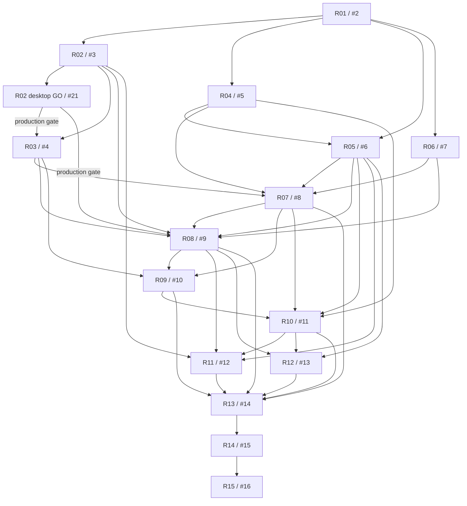

# Rust rewrite issue index

Revised 2026-10-13 for a native Windows GUI product. All issues are open and unassigned; implementation has not started.

Tracker: [#1 — Native taskbar clock rewrite](https://github.com/tjorim/ElevenClock/issues/1).

Read [the source dissection and contracts](RUST_REWRITE_DISSECTION.md) before implementing an issue.
The [scope overview](RUST_REWRITE_PLAN.md) defines retained features and datetime semantics.

Normal use is entirely through the Windows app: Start menu launch, native Settings,
live preview, in-app Support and opt-in startup. Storage encoding is private.
Developer probes/tests are not shipped as user tools.

## Execution backlog

| Phase / item | Issue | Prerequisites |
| --- | --- | --- |
| P0 / R01 | [#2 — Bootstrap native Windows app, Rust contracts and CI](https://github.com/tjorim/ElevenClock/issues/2) | None |
| P1 / R02 feasibility | [#3 — Build taskbar discovery probe and record hosted feasibility evidence](https://github.com/tjorim/ElevenClock/issues/3) | [#2](https://github.com/tjorim/ElevenClock/issues/2) |
| Shared desktop backlog (initial P1 / R02 gate) | [#21 — Desktop checks blocked by hosted-runner limitations](https://github.com/tjorim/ElevenClock/issues/21) | Source issue, documented hosted limitation, suitable desktop conditions |
| P1 / R03 | [#4 — Prove a non-activating clock overlay and native calendar access](https://github.com/tjorim/ElevenClock/issues/4) | [#3](https://github.com/tjorim/ElevenClock/issues/3); [#21](https://github.com/tjorim/ElevenClock/issues/21) GO before production overlay readiness |
| P2 / R04 | [#5 — Implement validated datetime formatting and explicit ISO week-date presets](https://github.com/tjorim/ElevenClock/issues/5) | [#2](https://github.com/tjorim/ElevenClock/issues/2) |
| P2 / R05 | [#6 — Implement private per-user preference persistence and recovery](https://github.com/tjorim/ElevenClock/issues/6) | [#2](https://github.com/tjorim/ElevenClock/issues/2), [#5](https://github.com/tjorim/ElevenClock/issues/5) |
| P2 / R06 | [#7 — Implement deterministic scheduling and per-taskbar visibility state](https://github.com/tjorim/ElevenClock/issues/7) | [#2](https://github.com/tjorim/ElevenClock/issues/2) |
| P3 / R07 | [#8 — Build DirectWrite clock rendering with DPI, theme and overflow handling](https://github.com/tjorim/ElevenClock/issues/8) | [#4](https://github.com/tjorim/ElevenClock/issues/4), [#5](https://github.com/tjorim/ElevenClock/issues/5), [#6](https://github.com/tjorim/ElevenClock/issues/6), [#7](https://github.com/tjorim/ElevenClock/issues/7) |
| P3 / R08 | [#9 — Integrate event-driven runtime, multi-monitor reconciliation and Explorer recovery](https://github.com/tjorim/ElevenClock/issues/9) | [#3](https://github.com/tjorim/ElevenClock/issues/3), [#4](https://github.com/tjorim/ElevenClock/issues/4), [#6](https://github.com/tjorim/ElevenClock/issues/6), [#7](https://github.com/tjorim/ElevenClock/issues/7), [#8](https://github.com/tjorim/ElevenClock/issues/8) |
| P3 / R09 | [#10 — Finish clock actions, tray controls and accessible native interaction](https://github.com/tjorim/ElevenClock/issues/10) | [#4](https://github.com/tjorim/ElevenClock/issues/4), [#8](https://github.com/tjorim/ElevenClock/issues/8), [#9](https://github.com/tjorim/ElevenClock/issues/9) |
| P4 / R10 | [#11 — Build native Windows Settings with format preview and complete preference flow](https://github.com/tjorim/ElevenClock/issues/11) | [#5](https://github.com/tjorim/ElevenClock/issues/5), [#6](https://github.com/tjorim/ElevenClock/issues/6), [#8](https://github.com/tjorim/ElevenClock/issues/8), [#10](https://github.com/tjorim/ElevenClock/issues/10) |
| P4 / R11 | [#12 — Add in-app support status, Copy diagnostics and bounded local logs](https://github.com/tjorim/ElevenClock/issues/12) | [#3](https://github.com/tjorim/ElevenClock/issues/3), [#6](https://github.com/tjorim/ElevenClock/issues/6), [#9](https://github.com/tjorim/ElevenClock/issues/9), [#11](https://github.com/tjorim/ElevenClock/issues/11) |
| P4 / R12 | [#13 — Implement opt-in per-user login startup with distinct app identity](https://github.com/tjorim/ElevenClock/issues/13) | [#6](https://github.com/tjorim/ElevenClock/issues/6), [#9](https://github.com/tjorim/ElevenClock/issues/9), [#11](https://github.com/tjorim/ElevenClock/issues/11) |
| P5 / R13 | [#14 — Run Windows compatibility, recovery and performance acceptance gates](https://github.com/tjorim/ElevenClock/issues/14) | [#8](https://github.com/tjorim/ElevenClock/issues/8), [#9](https://github.com/tjorim/ElevenClock/issues/9), [#10](https://github.com/tjorim/ElevenClock/issues/10), [#11](https://github.com/tjorim/ElevenClock/issues/11), [#12](https://github.com/tjorim/ElevenClock/issues/12), [#13](https://github.com/tjorim/ElevenClock/issues/13) |
| P5 / R14 | [#15 — Package native x64 releases and verify licensing, install and rollback](https://github.com/tjorim/ElevenClock/issues/15) | [#14](https://github.com/tjorim/ElevenClock/issues/14) |
| P5 / R15 | [#16 — Cut over to Rust and retire legacy runtime/build workflows](https://github.com/tjorim/ElevenClock/issues/16) | [#15](https://github.com/tjorim/ElevenClock/issues/15) |

## Phase gates

- **P0:** #2 establishes contracts and checks. Start here.
- **P1:** #3 completes the probe/hosted-feasibility milestone. #21 owns unavailable native x64/mixed-DPI desktop variants; hosted hit testing and UIA failure/lifetime validation remain in #4/#9. Their combined GO and overlay evidence are required before production Explorer integration. Completing #3 does not unblock that gate. Prototype experiments may progress independently.
- **P2:** #5 and #7 can run independently after #2; #6 follows #5. This work can progress alongside P1.
- **P3:** #8 → #9 → #10 produces a usable, recoverable native clock.
- **P4:** #11 completes Settings; #12 in-app Support and #13 startup can then proceed independently.
- **P5:** #14 → #15 → #16 validates, packages and proposes the final cutover. Do not auto-merge main.

## Dependency graph

Shared #21 can accept checks from other issues only after a documented hosted
attempt/limitation; each entry names its own consumer gate. The graph below shows
the initial R02 consumers, not a blanket dependency for all future rewrite work.

## Assigning agents

- **Good first assignments:** #2 foundation, then #5 formatter and #7 scheduler/state. #6 combines pure config logic with Windows persistence tests.
- **Needs Windows expertise:** #3 discovery, #4 overlay spike, #8 rendering, #9 lifecycle and #10 accessibility.
- **Needs an interactive Windows environment:** all shell/UI validation, startup and packaging checks; #14 additionally needs the documented eight-hour soak.
- Branch from `rust-rewrite` after prerequisite PRs are merged; one issue per PR. R01 creates that integration branch with these planning documents.
- Every issue contains source locations, owned files, scope, non-goals, test instructions, acceptance checkboxes and handoff requirements.
- Keep shared contracts stable. Report missing environment access instead of fabricating manual results.
- The JSON [issue specifications](rewrite-issue-specs.json) are the current planning snapshot; GitHub issue discussion/acceptance state is authoritative after dispatch.
