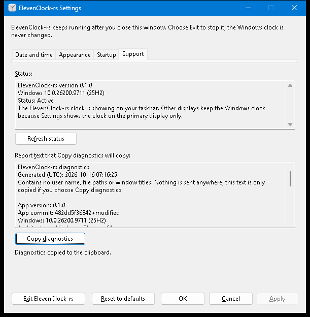

# R11 in-app support status, Copy diagnostics and bounded local logs

Status: **implemented and exercised against the real app on a real Windows 11
desktop at 100% scale** (Windows 11 Home 10.0.26200, two 1280×720 displays, release
build of this branch, no hosted CI run yet). Narrator speech, DPI above 100%, high
contrast and a clipboard held by a third-party program were **not** exercised; they
stay unchecked at the end.

## What the user gets

Settings → **Support** (reachable by `Ctrl+PageDown` or the tab strip) replaces the R10
placeholder:



| Control | Behaviour |
| --- | --- |
| **Status** (read-only text) | App version, Windows build, a one-word state and a plain explanation. When the native clock is showing, the text says why and what to do (see the table below) |
| **Refresh status** (`Alt+F`) | Asks for a fresh, bounded discovery. The window stays responsive; the line below the page says "Checking the taskbars...", then "Status refreshed." |
| **Report text that Copy diagnostics will copy** (read-only, selectable) | Exactly the text that will be copied |
| **Copy diagnostics** (`Alt+D`) | Writes that text to the clipboard **only on this click**. The line below the page says "Diagnostics copied to the clipboard." or what went wrong |

Tab order on the page: status, Refresh status, report, Copy diagnostics. The result line
raises a screen-reader alert (`EVENT_SYSTEM_ALERT`) whenever it changes, the same way
Settings' main status line does.

### Status states

| State | When | What it says to do |
| --- | --- | --- |
| Active | The clock is on every selected taskbar | Nothing. Displays the user left out in Settings are mentioned, never counted as a problem |
| Active on some taskbars | At least one but not all selected taskbars | Names each remaining taskbar and why |
| Active, clock hidden for now | Hidden by design (full screen, locked, taskbar auto-hidden) | It returns by itself |
| Paused | The user paused from the clock/tray menu | Choose Resume |
| Windows clock in use | Position unverified, unusable geometry, text does not fit, draw/placement failure, calendar action failed, discovery failed, Explorer not running, discovery turned off | One actionable sentence per cause: shorter format or smaller font, Pause then Resume, restart Explorer, Exit and start again, "this Windows version may not be supported yet" |
| Looking for the taskbar | Discovery has not answered yet | Wait |

## The report

[A real sample](images/diagnostics/sample-report.txt), produced by the harness on the machine above:

```text
ElevenClock-rs diagnostics
Generated (UTC): 2026-10-16 07:16:25
Contains no user name, file paths or window titles. Nothing is sent anywhere; this text is only copied if you choose Copy diagnostics.

App version: 0.1.0
App commit: 482dd5f36842+modified
Windows: 10.0.26200.9711 (25H2)
Architecture: Windows x64, app x64

Clock replacement: Active
Summary: The ElevenClock-rs clock is showing on your taskbar. Other displays keep the Windows clock because Settings shows the clock on the primary display only.
Paused by user: no
Windows Explorer running: yes
Taskbar discovery: last attempt succeeded

Taskbars: 2
1. Primary taskbar: clock replaced
   Monitor: 1280x720 px at (0, 0), DPI 96 (100%)
   Discovery strategy: UI Automation; clock located: yes
2. Secondary taskbar: not used: this display is not selected in Settings (Appearance)
   Monitor: 1280x720 px at (1280, 0), DPI 96 (100%)
   Discovery strategy: UI Automation; clock located: yes
```

It is plain text for a person, with no schema: the layout may change between versions
and nothing parses it. The commit is recorded by `clock-windows/build.rs` (`+modified`
marks a build from uncommitted changes; `unknown` means no git checkout).

### Privacy

- **By construction** the report has no field for a user name, a path or a window title:
  it is built only from the runtime's `Diagnostics` value plus version/OS facts.
- **Free text** (failure reasons from the platform) goes through `support::redact`
  before it is written: the signed-in user's profile folder and everything after it, any
  other `C:\...`, `C:/...`, `\\server\...` or `\\?\...` path becomes `<path>`, and the
  user name becomes `<user>` (case-insensitive, whole words only). Reasons are also
  flattened to one line and cut at 200 characters.
- **Nothing is sent**: there is no network code, upload, telemetry or crash reporter.
  The only way text leaves the app is the user's click on Copy diagnostics.

## Bounded refresh, with no blocking

`Runtime::refresh_status()` requests the ordinary discovery as if the display layout had
changed (a 250 ms settle, then the existing helper process with its five second
deadline, never UI Automation on the UI thread). The answer arrives as a normal
`Input::Discovery`, which bumps `Diagnostics::discovery_completed`. `RefreshWatch` (pure,
in `support`) turns that into Waiting / Done / TimedOut:

| Situation | Result |
| --- | --- |
| Answer arrives | "Status refreshed." and the page shows the new state |
| Helper fails or hits its deadline | Still an answer: a failure report, shown with its reason ("Taskbar discovery did not finish in time.") |
| Nothing arrives within 10 s (`REFRESH_LIMIT`) | "Checking the taskbars took too long. Showing the last known status. Choose Refresh status to try again." |
| Discovery is turned off for the session | Done at once; the status explains it |
| Refresh clicked again while one is running | "Still checking the taskbars."; no second request |

The Refresh button is never disabled, so the keyboard cannot be stranded on a disabled
control. The page rewrites its text only when the diagnostics changed.

## Copy diagnostics and the clipboard

`support::WindowsClipboard` writes `CF_UNICODETEXT` in this order, so every failure that
can happen before the old contents are replaced leaves them alone:

1. Allocate and fill the global memory. Failure → "Windows is low on memory." Clipboard
   untouched.
2. `OpenClipboard` with the dialog as owner, up to 5 attempts 10 ms apart (about 40 ms
   on the UI thread, in total). Failure → "Another program is using the clipboard. Wait a
   moment and choose Copy diagnostics again. Your clipboard was not changed."
3. `EmptyClipboard`, then `SetClipboardData`. If the second call fails the message says
   "The clipboard was cleared." instead (the only window in which contents are lost;
   Windows offers no atomic replace).

## Bounded local log

`logging::RotatingLog` keeps `elevenclock-rs.log`, `.1.log` and `.2.log` in
`%LOCALAPPDATA%\ElevenClock-rs\logs`: at most three files of 1 MiB (`MAX_FILE_BYTES`,
`MAX_FILES`), a line is cut at 1 KiB, and rotation happens before a write could exceed
the limit. It logs **transitions**, not repaints: a taskbar's outcome changing, a
discovery failure or recovery, pause/resume, discovery turned off, a refresh request,
a copy, a failed save, start and stop, and a panic message. `Runtime::transition_lines`
compares against what it last logged, so a minute of ticks writes nothing.

Every write error (no folder, disk full, locked file) is swallowed and the next write
starts from a fresh look at the disk. Only the primary instance logs. Lines pass through
`support::redact`. Sample from the harness run:

```text
2026-10-16T07:12:32Z ElevenClock-rs 0.1.0 started
2026-10-16T07:12:33Z primary taskbar 1: clock replaced
2026-10-16T07:12:33Z secondary taskbar 2: clock hidden for now: this display is not selected in Settings (Appearance)
2026-10-16T07:12:42Z status refresh requested
2026-10-16T07:12:44Z diagnostics copied to the clipboard
2026-10-16T07:12:48Z ElevenClock-rs stopped
```

## Where the code is (and one deliberate deviation from the issue)

The issue names `clock-app/src/{diagnostics,logging}.rs`. The dependency direction is
app → windows, but Settings (in `clock-windows`) must show the report and the runtime
(in `clock-windows`) produces the transition lines, so the report and the writer live
in `clock-windows`:

| File | Owns |
| --- | --- |
| `clock-windows/src/support.rs` (+ `support/native.rs`) | Status wording, report, redaction, `RefreshWatch`, clipboard wording and trait; Windows build/architecture; the clipboard |
| `clock-windows/src/logging.rs` | `RotatingLog`, global best-effort `log`, `init` |
| `clock-windows/build.rs` | Records the commit |
| `clock-windows/src/runtime.rs` | `Diagnostics` gains monitor bounds, DPI, strategy, `clock_located`, `shell_running`, `discovery_pending`, `discovery_completed`; `refresh_status`; `transition_lines` |
| `clock-windows/src/settings.rs`, `clock-app/resources/settings.rc` | The Support page |
| `clock-app/src/logging.rs` | Starts logging, panic hook, start/stop lines |

No dependency was added (`tracing` and `clap` are not used); the `windows` crate gains
the `Win32_System_DataExchange` feature. `preferences_store::app_data_dir` is the one
Known Folder lookup, now shared by preferences and logs.

## Verification

Run on Windows 11 (10.0.26200), stable Rust 1.99.1, this branch:

| Command | Result |
| --- | --- |
| `cargo fmt --manifest-path rust/Cargo.toml --all --check` | clean |
| `cargo clippy --manifest-path rust/Cargo.toml --workspace --all-targets --locked -- -D warnings` | clean |
| `cargo test --manifest-path rust/Cargo.toml --workspace --all-targets --locked` | all pass; `clock-windows` lib 176 passed (R11 adds 17 `support`, 2 Windows build/architecture, 7 `logging` and 6 runtime tests) |
| `cargo test --manifest-path rust/Cargo.toml --workspace --doc --locked` | pass |
| `cargo test -p clock-windows --test clipboard_native --locked -- --ignored --test-threads=1` | 2 passed: exact multi-line Unicode round trip; a clipboard held by another thread makes `set_text` return `Busy` in well under 500 ms, `replaced == false`, and the old text is still there afterwards |
| `scripts/test-rust-settings.ps1` | passes, now including the Support step below |
| PE header of the release `elevenclock-rs.exe` | subsystem 2 (Windows GUI): no console is created or attached |

The Support step of the harness drives the real window with the Windows input queue:
status shows version, `Windows 10.0.<build>` and `Status:`; the report has every field
and contains neither `%USERNAME%`, `%USERPROFILE%` nor `C:\Users`; Tab order on the page
is 1501 → 1502 → 1503 → 1504; `Alt+F` runs Refresh status and "Status refreshed." appears;
opening and refreshing Support leaves a sentinel clipboard value alone; `Copy
diagnostics` reports success and the clipboard equals the previewed text exactly; the log
exists, records the start, holds no user name, and no file exceeds 1 MiB. The clipboard is
restored afterwards. The unit tests cover report layout (golden text), redaction, status
wording for every state, refresh with success, helper deadline, a helper that never
answers, discovery off and a finished app, log rotation and every disk-error path.

Added after the first pass, in the same Support step of `scripts/test-rust-settings.ps1`
(run locally at 100% on the machine above; CI repeats it at 100/125/150/200% and in high
contrast through `test-rust-ui-environment.ps1`, which launches this script per case):

- **Layout:** every Support control lies inside its page and no two overlap, so nothing is
  clipped or covered at any scale.
- **Accessible names** (the default IAccessible a reader queries): status = "Status:",
  refresh = "Refresh status", report = "Report text that Copy diagnostics will copy:",
  copy = "Copy diagnostics"; all keyboard-focusable.
- **Announcements:** a WinEvent hook sees the result line raise `EVENT_SYSTEM_ALERT` twice
  for Refresh status (started, finished) and once for the copy result. This proves the
  event is sent, not what a particular reader says.
- **Clipboard held by another process:** a separate PowerShell process holds the clipboard
  open; Copy reports "Another program is using the clipboard...", "Your clipboard was not
  changed.", returns well inside 3 s with the window still enabled, and the sentinel text
  is intact once the holder lets go. This replaces the thread-based stand-in in the manual
  list.

## Still unchecked (need a person at a desktop)

- [ ] Narrator itself reads the result line and the fields in a sensible order (the data
      and events it relies on are verified above; its speech is not).
- [ ] Look at the page at 125%, 150%, 200% and in high contrast. CI captures it and checks
      layout; a person has not looked at the pictures. Running that matrix locally changes
      the display scale of the machine, so it was left to CI.
- [ ] A real taskbar with an unverifiable clock (a Windows build where discovery fails)
      to read the "Windows clock in use" wording in place. The wording is unit-tested.

## Known limits

- Clipboard access waits up to about 40 ms on the UI thread; that is the price of an
  immediate, predictable result instead of an asynchronous retry.
- If `SetClipboardData` itself fails after the clipboard was emptied, the old contents
  are gone (the message says so).
- Logging starts after the single-instance check, so a launch that only signals the
  running copy does not log, and failures before the primary instance exists are not logged.
- Per-taskbar ids in the log are process-local and restart at each Explorer generation.
