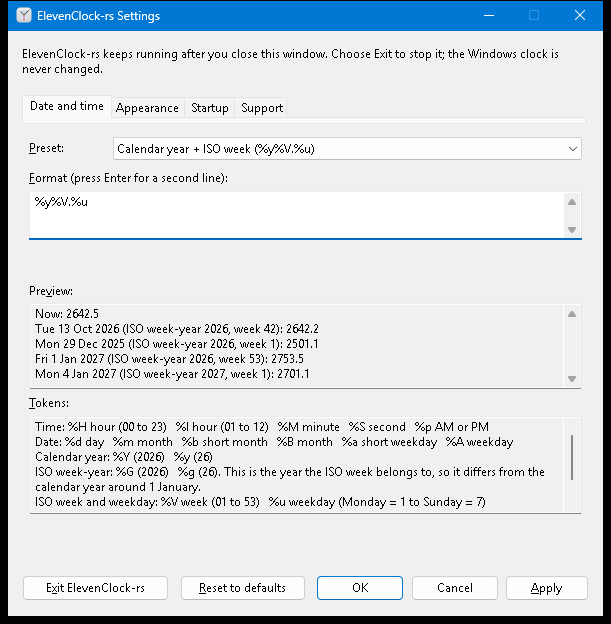
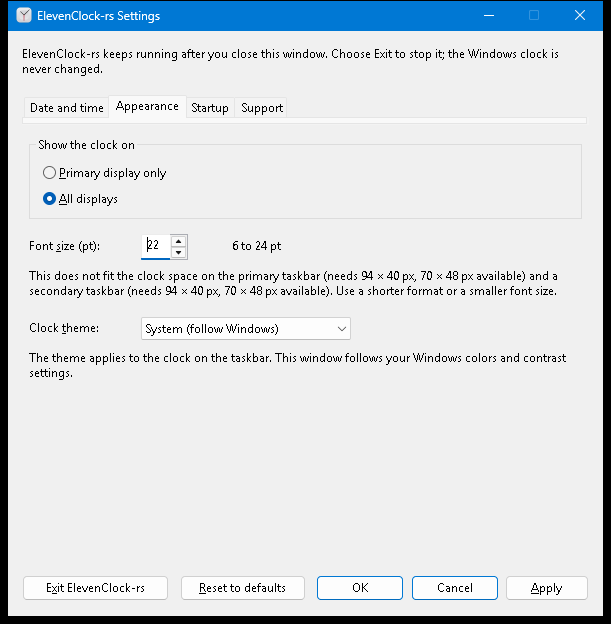

# Native Settings and the preference flow

## What the user gets

One window, four pages (a tab strip; `Ctrl+Tab`, `Ctrl+Shift+Tab` and
`Ctrl+PageUp/PageDown` also switch pages):

| Page | Contents |
| --- | --- |
| Date and time | Preset list (from `clock_core::format::PRESETS`, plus *Custom format*), multi-line format editor, live preview, token help |
| Appearance | Primary display only / All displays, font size 6–24 pt with spin buttons, clock theme System / Light / Dark |
| Startup | The opt-in login-startup checkbox ([details](startup.md)). It is the Windows registration itself, not a stored preference, so nothing can drift from the OS-owned state |
| Support | Status, Refresh status and Copy diagnostics ([details](diagnostics.md)) |

Below every page, Settings shows the running app version, taken from the same
Cargo workspace version as the executable's file properties. **Check for updates**
opens [the latest GitHub release](https://github.com/tjorim/ElevenClock-rs/releases/latest)
in your default browser. The app makes no network request. The button supports
Tab followed by Enter or Space; an opening failure appears in the Settings status.
Managed copies show “managed by your organization” beside the version and hide
this button, because their launcher handles updates.

Buttons: **Exit ElevenClock-rs**, **Reset to defaults**, **OK**, **Cancel**, **Apply**.

The window uses the Windows 11 text font (Segoe UI Variable) and the Mica material
behind its title bar, through the documented `DWMWA_SYSTEMBACKDROP_TYPE`. The client
area keeps standard themed controls, so it follows high contrast and screen readers
unchanged; Windows builds without Mica simply show the plain title bar.

### Flow

| Action | Result |
| --- | --- |
| Edit anything | Draft only. Messages and the preview update as you type; nothing is live or saved. **Apply** enables once the draft differs from what is live |
| **Apply** | Validate, check fit, **save**, and only then tell the running clock (`Input::Preferences`). The clock changes without a restart; the window stays open and says "Settings applied." |
| **OK** | Apply, then close. With no changes it simply closes |
| **Cancel**, Esc, the close button, `Alt+C` | Discard the draft and close. The clock keeps running |
| **Reset to defaults** | Stage the defaults in the controls. Nothing is saved until Apply; Cancel drops them |
| Save fails | "Settings were not saved. … Your previous settings are preserved." The live clock is unchanged, the draft stays editable, the window stays open and Apply can simply be retried ([capture](images/settings/save-failed.png)) |
| Invalid draft | Apply refuses, says so, moves the keyboard to the first problem and selects the offending token ([capture](images/settings/invalid-format.png)) |
| Damaged saved data | A notice at the bottom; defaults are shown. Apply asks for confirmation, keeps a copy of the damaged data, then saves ([notice](images/settings/damaged-notice.png), [confirmation](images/settings/recover-damaged.png)). Declining changes nothing |
| Saved data from a newer version | Everything is disabled and the notice says saving is turned off; the data is never overwritten |
| First launch | Welcome text; first-run completion is stored internally when the window is dismissed. Later launches show the normal text. A login-style start never opens Settings |
| Launch while running / tray or clock menu **Settings** | The running instance shows or focuses the one window. An already-open window keeps its unsaved edits |
| **Exit** | Explicit: removes the overlay, tray icon and helper. Closing never exits |

## Preview and year-boundary semantics

The preview always shows the current time and the documented examples, with the ISO
week-year each belongs to, so the difference between `%g` (ISO week-year) and `%y`
(calendar year) is visible instead of implied:

| Sample (12:34:56) | `%g%V.%u` (ISO week date) | `%y%V.%u` (Calendar year + ISO week) |
| --- | --- | --- |
| Tue 13 Oct 2026 (ISO week-year 2026, week 42): **the fixture** | 2642.2 | 2642.2 |
| Mon 29 Dec 2025 (ISO week-year 2026, week 1) | 2601.1 | 2501.1 |
| Fri 1 Jan 2027 (ISO week-year 2026, week 53) | 2653.5 | 2753.5 |
| Mon 4 Jan 2027 (ISO week-year 2027, week 1) | 2701.1 | 2701.1 |

The token help beside the editor lists every directive the core accepts (a test
compares it with `format::DIRECTIVES`) and explains that `%G`/`%g` are the year the
ISO week belongs to. Two-line formats show `line 1 ↵ line 2`.

## Messages (always beside the control)

| Input | Message | Where |
| --- | --- | --- |
| `%Q` | "“%Q” is not a supported token. The token list below shows what you can use." | Under the format editor; the token is selected on Apply |
| trailing `%` | "A % must be followed by a token. Use %% to show a percent sign." | same |
| empty / empty line | "Enter a format, or choose a preset." / "Each line needs some content…" | same |
| three lines, control characters, > 256 characters, > 512 rendered | one sentence each (see `settings_model::format_problem`) | same |
| font `30`, `5`, empty, `abc` | "Font size must be between 6 and 24 pt." | Under the font size |
| does not fit | "This does not fit the clock space on the primary taskbar (needs 94 × 40 px, 70 × 48 px available) and a secondary taskbar (…). Use a shorter format or a smaller font size." | Under the format **and** under the font size |

**Fit** is measured, not guessed: `Runtime` hands the draft to the same DirectWrite
measurement the overlay surface uses (`Renderer::plan_fit`), against the clock slot
discovered for each taskbar the selection would use, at that taskbar's DPI, using the
same worst-case lines (leap day, ISO week 53, AM/PM). If a taskbar has no proven clock slot, or nothing was discovered yet,
there is nothing to measure and Apply is not blocked; the paint path still reports a
later overflow, and Settings shows that as a notice when it is open.

## Implementation notes

* All rules live in the portable `clock_windows::settings_model` (`Draft`,
  `SettingsController`, `Evaluation`, `Problems`, `ApplyOutcome`, `LayoutCheck`) and are
  unit-tested on any OS with a fake store and a fake layout.
* `SettingsWindow` owns the `PreferenceSession` and is serviced from the one message loop.
  Window procedures only queue values; nothing re-enters the runtime from a callback.
* `preferences_store::UnavailableStore` is used when the per-user data folder cannot be
  resolved: the clock runs on defaults, and every save fails visibly instead of being
  lost at the next start.
* Multi-line edit controls send no `EN_CHANGE` when their text is set from outside the
  process (automation, some assistive technology), so the controls, not the
  notifications, are read at the start of every command. Input that arrives as a *sent*
  message never wakes `GetMessageW`, so each queued event also posts a wake message to
  the dialog.

## Fit-check caching

Settings retains one draft format's sampled worst-case candidates. Repeated fit
checks reuse successful measurements while rendered text, selected clock slots,
DPI, font size and the runtime appearance/font revision are unchanged. A different
format replaces the candidate cache; unavailable or failed measurements are never
cached as successful fits. Both caches are bounded to the current draft/check.
Operation-count guards for this cache and for the worst-case resampling are listed in
[contributing](../contributing.md#performance-and-resource-guards).

## Action audit

Audited for issue #82: the existing small typed `interaction::MenuCommand` model
already owns command IDs and the fixed menu. No additional action abstraction is
needed for current behavior.

| Entry points | Policy and dispatch owner | Existing evidence |
| --- | --- | --- |
| Clock right click; tray mouse, keyboard and context-key activation | Queue `Interaction::Menu`; native pump routes to `UserAction::ShowMenu`; `interaction::menu_items` and `Runtime::command` share Settings, Pause/Resume and Exit | `tray` decoder tests; `runtime/tests.rs` menu dispatch and tray coalescing tests |
| Clock click; screen-reader Invoke | Queue activation; runtime checks the current overlay and activation gate before the native calendar action | `interaction` press/gate/queue tests and runtime activation tests; hosted overlay harness for native input/UIA |
| Menu Settings; second-instance launch | Native show request converges on `SettingsWindow::show_or_focus`; an existing draft is retained | Settings desktop harness for window/focus behavior |
| Menu Exit; Settings Exit; host close/session end | Menu calls runtime quit; Settings/host queue Exit, pumped as `Input::Quit`; runtime owns teardown | Runtime menu-exit, quit and end-session tests; lifecycle harness for native teardown |
| Apply/OK; Reset; Cancel/close | Settings controller owns validation/save/recovery; OK closes only after success, Reset stages a draft, Cancel discards it | `settings_model` and `preferences_store` portable tests; Settings desktop harness |
| Check for updates | Settings queues the button command, rejects it in managed mode, then opens the fixed release URL through the shell on the UI thread; failures use the announced Settings status | Settings desktop harness checks version, accessible name and tab order; browser activation requires Windows desktop verification |
| Startup checkbox; Support Refresh/Copy | Separate typed startup/support policies, serviced outside callbacks; startup changes require explicit user action | Startup/support portable tests and native registry/clipboard tests |

Pause/Resume is available through the shared menu; Settings does not duplicate it.
Settings opening and Exit are unconditional requests, so their small native adapters
contain no competing availability policy. Unsupported preference versions disable
saving in the Settings model and remain protected at the store boundary. These
layers enforce different boundaries rather than duplicating action policy.
Revisit this audit when adding an entry point or conditional action; centralize
proven shared availability/behavior in portable typed logic and test every affected
source. Do not unify draft commands, OS registration and clock actions speculatively.
