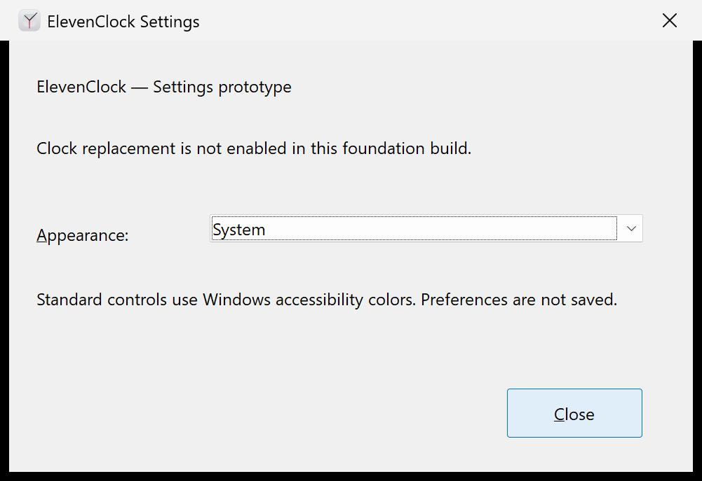
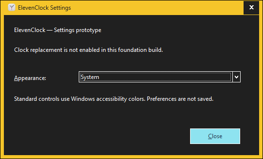

# R01 native Settings foundation evidence

Status: **R01 foundation checks pass**. The native prototype was exercised on a
real Windows CI desktop, including queued keyboard input, the actual Windows
high-contrast setting and actual display scaling at 100/125/150/200%. The full
Windows 11 end-user acceptance journey remains in R13; this foundation record
does not establish the final support list or screen-reader/mixed-monitor coverage.

[PR #19](https://github.com/tjorim/ElevenClock/pull/19) targets `rust-rewrite`.
[Run 38464403335](https://github.com/tjorim/ElevenClock/actions/runs/38464403335)
passed all five jobs on feature commit `425c1f7e0acc7c4ad0f499e63fe867076298752d`;
the checked-out PR merge revision was `35bee7826e9e6178c8ded55dc96d99587cdc5195`.
This includes Linux core checks, Windows MSRV/stable formatting, checks, Clippy,
tests/doc tests, locked x64 MSVC release builds and dependency advisory/license
checks. The GUI subsystem, embedded DPI-v2 manifest/dialog/icon and native
launch/close checks passed on both toolchains.

## Actual DPI and high-contrast matrix

Windows Server 2025 Datacenter, version 10.0.26100; runner image
`windows-2025-vs2026`, version `20260925.250.1`. Stable prototype SHA-256:
`306402bb1abd9e5f6770febdcbf328e50811c3a061b1535c2bc9923013fe10f5`.
The [artifact](https://github.com/tjorim/ElevenClock/actions/runs/38464403335/artifacts/11848761110)
contains that executable, original images and the environment/context records.

| Case | Actual window DPI | Observed outcome | Original capture/context |
| --- | ---: | --- | --- |
| 100% | 96 | Readable text, labels and controls; visible keyboard focus; no internal clipping | [Image](R01-matrix/scale-100/settings.png), [context](R01-matrix/scale-100/context.json) |
| 125% | 120 | Readable text, labels and controls; visible keyboard focus; no internal clipping | [Image](R01-matrix/scale-125/settings.png), [context](R01-matrix/scale-125/context.json) |
| 150% | 144 | Readable text, labels and controls; visible keyboard focus; no internal clipping | [Image](R01-matrix/scale-150/settings.png), [context](R01-matrix/scale-150/context.json) |
| 200% | 192 | Readable text, labels and controls; visible keyboard focus; no internal clipping | [Image](R01-matrix/scale-200/settings.png), [context](R01-matrix/scale-200/context.json) |
| High Contrast Black | 96 | High contrast enabled in Windows; white text on dark background; readable selection/button and visible focus | [Image](R01-matrix/high-contrast/settings.png), [context](R01-matrix/high-contrast/context.json) |

All five original images were inspected. The black outer margins in ordinary
captures are PrintWindow's rendering of non-client margins, outside the controls.





These DPI values were **not injected WM_DPICHANGED messages or resized images**.
The harness changes the Windows Settings Display Scale selector with UI
Automation, then independently requires `GetDpiForWindow` to report 96, 120,
144 or 192 on the actual app HWND. Windows' initial 1024x768 mode exposes only
100/125%; the harness enumerates supported driver modes and uses 1600x1200
through the documented display-mode APIs so Settings exposes 150/200% as well.
It restores the original scale and display mode in finally blocks.

High contrast is enabled through the documented `SPI_SETHIGHCONTRAST` API and
verified through `SPI_GETHIGHCONTRAST`, not a mock flag in the app. The observed
scheme was High Contrast Black, flags 127, window/button face `0x202020` and
window text `0xFFFFFF`. The original high-contrast flags/scheme are restored.
[The environment record](R01-matrix/environment.json) retains modes, actual
resolution, scale choices and colors. Microsoft marks
`SPI_SETLOGICALDPIOVERRIDE` as "Do not use"; the harness does not call it.

## Keyboard and initial UI contract

The actual Windows input queue (`SendInput`) was used after verifying that the
app window had foreground focus. Tab advances Appearance → Close; Shift+Tab
returns to Appearance; Alt+A focuses the labelled Appearance combo. Down/Up
arrows select Light/Dark and return to System. The live GUI thread's focus and
native combo selection are checked after each gesture. These tests passed at
all four actual DPIs and in high contrast.

Alt+C closed the high-contrast prototype. Independent runs verify
[Escape](R01-matrix/keyboard-escape/context.json) and
[Enter](R01-matrix/keyboard-enter/context.json). Native window-close messages
also exit normally, with no Explorer or native-clock modification. The Explorer file item was activated with a real queued left-button double-click.
The resulting process opened the native Settings window and exited with code 0
after Close. Artifact checks prove GUI subsystem and mandatory icon loading.
No console or public command suite is part of the app.

The native Oleacc `IAccessible` standard-control proxies report the combo's name
as `Appearance:`, its focusable state as true and role as 46 (combo box); the
Close button's name is `Close`. These results are retained alongside the
Explorer activation/exit result in the environment record. The test reads the
actual controls' accessibility metadata; it does not annotate or override names.
The legacy .NET UI Automation client on this runner omits classic-control
proxies, so the harness queries the native accessibility objects directly.
Full screen-reader speech and interaction on stock Windows 11 remain R13 work.

The Settings shell uses standard controls, native labels/mnemonics, the existing
repository icon, common-controls v6, `asInvoker` and PerMonitorV2. Default dialog
processing supplies focus and scaling. Closing this foundation prototype exits;
R08 owns the continuing clock/tray lifecycle. No preferences are written yet.

## Theme limitation and decision before R10

System and Light previews retain standard Windows accessibility colors. The
actual High Contrast Black check proves that selecting the preview's Light/Dark
items does not override Windows high contrast. Dark remains an explicitly
reported limitation, rather than an unsupported or silently ignored dark skin.

R01's initial UI criterion allows a documented blocking design decision before
R10. Universal dark styling of classic controls through supported APIs is still
not established. Before R10, choose accessible system-color controls for Settings
or evaluate a bounded native UI alternative; do not adopt undocumented theme
ordinals. R10 owns that decision and the complete form. This limitation does not
invalidate the passing DPI/high-contrast foundation evidence above.

## Foundation gate and later acceptance

- [x] Windows MSRV/stable locked checks, formatting, Clippy, tests/doc tests and release builds
- [x] Linux core checks without Windows dependencies; advisory/license checks retain notices
- [x] Actual Explorer double-click opens native Settings; GUI subsystem/icon verified; closes with exit 0
- [x] Keyboard queue: Tab/Shift+Tab, Alt+A/Alt+C, selection arrows, Enter/Escape and native close
- [x] Native accessibility metadata: Appearance/Close names and combo focusability/role verified
- [x] Actual 100/125/150/200% DPI: readable labels/controls, visible focus, no observed internal clipping
- [x] Actual Windows high contrast: readable controls, selection/button and visible focus
- [x] System/light/dark feasibility and the native-control limitation documented before R10
- [x] Shared contracts, toolchains, resource lifetimes and developer commands documented

Still unverified, and retained for R10/R13 rather than represented as P0 results:
stock Windows 11 builds/patches, screen-reader speech and interaction, movement
between mixed-DPI monitors, non-administrator installation, Start menu/first-run
journeys and the final complete Settings form. No supported Windows 11 build is
claimed from Server CI. The dissection's final acceptance checklist remains intact.

## Developer reproduction

On an ephemeral Windows desktop with the built prototype:

```powershell
pwsh -NoProfile -File scripts/test-rust-settings.ps1
powershell -NoProfile -File scripts/test-rust-ui-environment.ps1
```

The second command changes Windows high contrast, display resolution and scale
for the feasibility checks and restores the original settings. It requires a
supported display mode large enough for 200%; absence is an explicit failure.
Both scripts, UI Automation/Oleacc and captures are development-only artifacts and are
not bundled with the installed app. The scripts do not add an app command parser,
preferences interface, private DPI API or user-visible diagnostic command suite.

References: [SystemParametersInfo](https://learn.microsoft.com/en-us/windows/win32/api/winuser/nf-winuser-systemparametersinfow),
[EnumDisplaySettings](https://learn.microsoft.com/en-us/windows/win32/api/winuser/nf-winuser-enumdisplaysettingsw),
[ChangeDisplaySettingsEx](https://learn.microsoft.com/en-us/windows/win32/api/winuser/nf-winuser-changedisplaysettingsexw).

## Local command results

Source base: main 959d473902c4ce7b916815e165eccdb324f83496, local
`rust-rewrite` working tree. Linux x86_64; rustc 1.90.0
(1159e78c4 2025-09-14) and stable 1.99.0 (b940084d7 2026-09-28).

The following commands passed with each of `+1.90.0` and `+stable`:

```sh
cargo +TOOLCHAIN fmt --manifest-path rust/Cargo.toml --all --check
cargo +TOOLCHAIN test --manifest-path rust/Cargo.toml --workspace --locked
cargo +TOOLCHAIN test --manifest-path rust/Cargo.toml --workspace --doc --locked
cargo +TOOLCHAIN clippy --manifest-path rust/Cargo.toml --workspace --all-targets --locked -- -D warnings
cargo +TOOLCHAIN check --manifest-path rust/Cargo.toml --workspace --all-targets --locked --target x86_64-pc-windows-msvc
cargo +TOOLCHAIN clippy --manifest-path rust/Cargo.toml --workspace --all-targets --locked --target x86_64-pc-windows-msvc -- -D warnings
```

Each test run: one core geometry unit test and one rectangle doctest passed.
App/Windows host stubs contain zero Linux tests; this is not native coverage.
Explicit Linux `-p clock-core` tests and `-p clock-core --doc` also passed on
1.90.0. `cargo +1.90.0 tree --manifest-path rust/Cargo.toml -p clock-core --locked`
shows only chrono, num-traits and build-only autocfg, with no Windows dependencies.

`cargo +stable metadata --manifest-path rust/Cargo.toml --locked --format-version 1`
and `python3 scripts/rust-license-check.py <metadata.json>` passed, retaining
original dependency notices in `/workspace/scratch/dependency-notices.txt`.
Workflow/Dependabot YAML and the manifest XML parsed successfully.
`git diff --check` passed.

From the repository root the issue's original fmt command without `--all`
reported "Failed to find targets" on cargo-fmt 1.90 for this virtual workspace.
Using `--all` passes and is the command documented in CI/contributor instructions.

Advisory audit passed: cargo-audit 0.22.2, `cargo-audit audit --deny warnings`
from `rust/`; loaded 1,310 RustSec advisories and scanned 47 lockfile packages,
exit 0 with no findings/warnings. Used the upstream Linux release archive after
verifying its SHA-256 against GitHub release metadata; the slower source install
was stopped. CI installs the same version with `cargo install --locked`.
