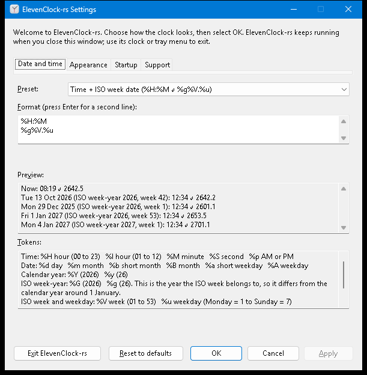

# R10 native Settings and the complete preference flow

Status: **implemented and exercised on a real Windows 11 desktop at 100% scale.**
The Date and time, Appearance, Startup and Support pages, live preview, field
messages, fit checks, Apply / Cancel / Reset / OK, first-run, damaged-data recovery,
save-failure handling and close-to-background all ran against the real window with
the Windows input queue. DPI above 100%, high contrast, dark colors, screen-reader
speech and mixed-DPI displays were **not** exercised; they stay unchecked below.

Environment: Windows 11 Home 10.0.26200 (25H2), two 1280×720 displays at 100%
(96 DPI), debug build of this branch. No hosted CI run yet.

## What the user gets

One window, four pages (a tab strip; `Ctrl+Tab`, `Ctrl+Shift+Tab` and
`Ctrl+PageUp/PageDown` also switch pages):

| Page | Contents |
| --- | --- |
| Date and time | Preset list (from `clock_core::format::PRESETS`, plus *Custom format*), multi-line format editor, live preview, token help |
| Appearance | Primary display only / All displays, font size 6–24 pt with spin buttons, clock theme System / Light / Dark |
| Startup | Reserved for R12: an explanation only. No checkbox and no stored boolean, so nothing can drift from the OS-owned state |
| Support | Reserved for R11: version and a pointer; the page is a read-only text field so it is reachable by keyboard and readers |

Buttons: **Exit ElevenClock-rs**, **Reset to defaults**, **OK**, **Cancel**, **Apply**.



### Flow

| Action | Result |
| --- | --- |
| Edit anything | Draft only. Messages and the preview update as you type; nothing is live or saved. **Apply** enables once the draft differs from what is live |
| **Apply** | Validate, check fit, **save**, and only then tell the running clock (`Input::Preferences`). The clock changes without a restart; the window stays open and says "Settings applied." |
| **OK** | Apply, then close. With no changes it simply closes |
| **Cancel**, Esc, the close button, `Alt+C` | Discard the draft and close. The clock keeps running |
| **Reset to defaults** | Stage the defaults in the controls. Nothing is saved until Apply; Cancel drops them |
| Save fails | "Settings were not saved. … Your previous settings are preserved." The live clock is unchanged, the draft stays editable, the window stays open and Apply can simply be retried ([capture](R10/save-failed.png)) |
| Invalid draft | Apply refuses, says so, moves the keyboard to the first problem and selects the offending token ([capture](R10/invalid-format.png)) |
| Damaged saved data | A notice at the bottom; defaults are shown. Apply asks for confirmation, keeps a copy of the damaged data, then saves ([notice](R10/damaged-notice.png), [confirmation](R10/recover-damaged.png)). Declining changes nothing |
| Saved data from a newer version | Everything is disabled and the notice says saving is turned off; the data is never overwritten |
| First launch | Welcome text; first-run completion is stored internally when the window is dismissed. Later launches show the normal text. A login-style start never opens Settings |
| Launch while running / tray or clock menu **Settings** | The running instance shows or focuses the one window. An already-open window keeps its unsaved edits |
| **Exit** | Explicit: removes the overlay, tray icon and helper. Closing never exits |

## Preview and year-boundary semantics

The preview always shows the current time and the documented examples, with the ISO
week-year each belongs to, so the difference between `%g` (ISO week-year) and `%y`
(calendar year) is visible instead of implied:

| Sample (12:34:56) | `%g%V.%u` (ISO week date) | `%y%V.%u` (Calendar year + ISO week) |
| --- | --- | --- |
| Tue 13 Oct 2026 (ISO week-year 2026, week 42): **the fixture** | 2642.2 | 2642.2 |
| Mon 29 Dec 2025 (ISO week-year 2026, week 1) | 2601.1 | 2501.1 |
| Fri 1 Jan 2027 (ISO week-year 2026, week 53) | 2653.5 | 2753.5 |
| Mon 4 Jan 2027 (ISO week-year 2027, week 1) | 2701.1 | 2701.1 |


The token help beside the editor lists every directive the core accepts (a test
compares it with `format::DIRECTIVES`) and explains that `%G`/`%g` are the year the
ISO week belongs to. Two-line formats show `line 1 ↵ line 2`.

## Messages (always beside the control)

| Input | Message | Where |
| --- | --- | --- |
| `%Q` | "“%Q” is not a supported token. The token list below shows what you can use." | Under the format editor; the token is selected on Apply |
| trailing `%` | "A % must be followed by a token. Use %% to show a percent sign." | same |
| empty / empty line | "Enter a format, or choose a preset." / "Each line needs some content…" | same |
| three lines, control characters, > 256 characters, > 512 rendered | one sentence each (see `settings_model::format_problem`) | same |
| font `30`, `5`, empty, `abc` | "Font size must be between 6 and 24 pt." | Under the font size |
| does not fit | "This does not fit the clock space on the primary taskbar (needs 94 × 40 px, 70 × 48 px available) and a secondary taskbar (…). Use a shorter format or a smaller font size." | Under the format **and** under the font size |


**Fit** is measured, not guessed: `Runtime` hands the draft to the same DirectWrite
measurement the overlay surface uses (`Renderer::plan_fit`), against the clock slot
discovered for each taskbar the selection would use, at that taskbar's DPI, using the
same worst-case lines (leap day, ISO week 53, AM/PM). On this machine a one-line
`%y%V.%u` needs 98 px at 23 pt and the slot is 70 px; the spin buttons turn the message
off at 15 pt. If a taskbar has no proven clock slot, or nothing was discovered yet,
there is nothing to measure and Apply is not blocked; the paint path still reports a
later overflow, and Settings shows that as a notice when it is open.

## Interfaces changed

* `clock_windows::settings_model` (new, portable): `Draft`, `SettingsController`,
  `Evaluation`, `Problems`, `ApplyOutcome`, `LayoutCheck`/`FitProblem`, `TOKEN_HELP`,
  `edit_selection`. All rules live here and are unit-tested on any OS.
* `SettingsWindow<S>` now owns the `PreferenceSession<S>` (the runtime starts from a
  clone of the active value) and is serviced from the one message loop:
  `show_or_focus(&mut runtime)`, `service(&mut runtime)`. Window procedures only queue
  values; nothing re-enters the runtime from a callback.
* `runtime::Platform::plan_fit` (default `None`) and `impl LayoutCheck for Runtime<P>`.
  `NativePlatform` answers through `Renderer::plan_fit`.
* `preferences_store::UnavailableStore`: used when the per-user data folder cannot be
  resolved. The clock still runs on defaults, but every save now fails visibly instead
  of appearing to succeed in memory and being lost at the next start.
* `settings.rc`: new tabbed template and four page dialogs. `Exit` (1003) keeps its id.
  The old *Close* became **Cancel** and keeps `Alt+C`.
* `scripts/test-rust-settings.ps1` rewritten for the new window (still the CI smoke
  step; same parameters).

Two behaviours found while testing and handled: multi-line edit controls send no
`EN_CHANGE` when their text is set from outside the process (automation, some assistive
technology), so the controls, not the notifications, are read at the start of every
command; and input that arrives as a *sent* message never wakes `GetMessageW`, so each
queued event also posts a wake message to the dialog.

## Verification (2026-10-16, Windows 11 25H2, x86_64 MSVC)

```text
cargo fmt --manifest-path rust/Cargo.toml --all --check
cargo clippy --manifest-path rust/Cargo.toml --workspace --all-targets --locked -- -D warnings
cargo test --manifest-path rust/Cargo.toml --workspace --all-targets --locked
cargo test --manifest-path rust/Cargo.toml --workspace --doc --locked
```

All four exit 0. `clock-windows` runs 144 unit tests (18 new: 15 for the settings
controller, 2 for the runtime fit check, 1 for `UnavailableStore`); every other
workspace unit, integration and doc test also passes. The controller tests use a fake store
and a fake layout: draft / apply / cancel / reset orchestration, persist-before-apply
ordering, failed save keeping live settings and the draft, recovery preserving the
original, unsupported versions never writing, first-run written exactly once, font
bounds, every format error kind with its selection, fit blocking Apply, and the
documented year-boundary previews.

Interactive harness against the debug build, one run per close gesture, each exit 0:

```text
powershell -File scripts/test-rust-settings.ps1 -Executable rust/target/debug/elevenclock-rs.exe -CloseGesture Window|Escape|Enter|Mnemonic
powershell -File scripts/test-rust-lifecycle.ps1 -Executable rust/target/debug/elevenclock-rs.exe -ExplorerRestarts 0 -IdleSeconds 5
```

The Settings harness checks, through the real input queue and real controls: welcome
text; every page and control present; Apply disabled when clean; tab order
`tabs → preset → format → preview → tokens → Exit → Reset → OK → Cancel → (wrap)`,
Shift+Tab and `Alt+F`; the fixture previewing `2642.2`; `2653.5` versus `2753.5` on
2027-01-01; typing a preset's format selecting that preset; `%Q` explained and refused
with nothing written; a valid edit applied and persisted; the font bound message; Cancel
discarding, the clock continuing, the second launch refocusing Settings with the saved
values; Reset staging without saving; and Exit releasing every process. The harness
saves and restores the user's preferences file.

Manual runs on the same desktop (captures in `R10/`): the live taskbar clock changing
to `2642.5` at 15 pt on Apply without a restart; the failed save with the preferences
file held open by another process (previous settings preserved, retry succeeded); the
damaged-file recovery with "No" and then "Yes" (a `.preserved` copy was written, the
original untouched until confirmed); saved data from a newer version (all editing
controls, Reset and Apply disabled, the notice shown, OK only closes, the file untouched); MSAA names and roles read through `oleacc` for every
control (labels such as "Format (press Enter for a second line):", "Font size (pt):",
"Clock theme:"; the spin buttons are named "Change font size").

## Unchecked (needs another environment)

- [ ] DPI 125 / 150 / 200% and moving between mixed-DPI monitors. Dialog units and the
      page anchor are DPI-independent and pages re-anchor on `WM_SIZE`, but only 96 DPI
      was run. The existing R01 matrix harness (`test-rust-ui-environment.ps1`) calls the
      rewritten smoke script and should be run in hosted CI.
- [ ] Windows high contrast and dark mode. Controls are standard system-color controls;
      the clock theme setting is for the taskbar clock only and says so.
- [ ] Narrator speech and focus announcements (names and roles verified through MSAA,
      status text raises `EVENT_SYSTEM_ALERT`; nothing was listened to).
- [ ] Start menu launch and first-run after a per-user install (R14); only the
      executable was launched.
- [ ] Hosted Windows 11 ARM64 / Server runs of the smoke script.
- [ ] Explorer restart while Settings is open (the lifecycle harness ran with
      `-ExplorerRestarts 0`).
