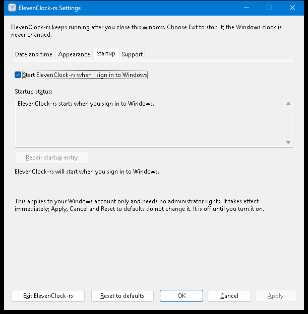

# R12 opt-in per-user login startup

Status: **implemented and exercised against the real app on a real Windows 11
desktop at 100% scale** (Windows 11 Home 10.0.26200, release build of this branch, no
hosted CI run yet). A real sign-out/sign-in, a standard (non-administrator) account,
DPI above 100%, high contrast and Narrator speech were **not** exercised; they stay
unchecked at the end.

## App identity and the owned registry value

| What | Value |
| --- | --- |
| Key | `HKEY_CURRENT_USER\Software\Microsoft\Windows\CurrentVersion\Run` |
| Value name | **`ElevenClockRust`** (`REG_SZ`) |
| Value data | `"<absolute path to elevenclock-rs.exe>" --startup` |
| Windows' own flag | `HKCU\...\Explorer\StartupApproved\Run`, value `ElevenClockRust` (read; deleted when the user turns startup on or off here) |

The legacy ElevenClock writes `elevenClock` to the same key. Registry value names are
case-insensitive, so the Rust app's name differs by more than case
(`startup::tests::value_name_never_collides_with_the_legacy_app`). Nothing else is ever
written, deleted or read for writing: no HKLM, no service, no scheduled task, no UAC.
`--startup` is the private marker R08 already owns (`instance::STARTUP_MARKER`): it
starts the clock quietly, never opens Settings, and does nothing when an instance is
already running (the existing per-user mutex).

## What the user gets

Settings → **Startup**:



| Control | Behaviour |
| --- | --- |
| **Start ElevenClock-rs when I sign in to Windows** (`Alt+S`) | The registration itself. Off by default. Acts **immediately** (it is OS state, not a draft: Apply, Cancel and Reset to defaults never touch it). After every action the page is rewritten from what the registry holds, so the box can only show the truth |
| **Startup status** (read-only text) | One of the states below, in words |
| **Repair startup entry** (`Alt+R`) | Enabled only when the entry is stale; re-points it at this executable |
| Result line | "ElevenClock-rs will start when you sign in to Windows.", "...will no longer start...", or the failure and "Startup was not turned on/off." Raises a screen-reader alert like the other status lines |

The page is read again whenever it is opened (also with `Ctrl+PageDown`), because Task
Manager and Windows Settings can change the registration while Settings is open.

### States

| State | Registry | Checkbox | Words |
| --- | --- | --- | --- |
| Off | no value | clear | "does not start when you sign in" |
| On | exact quoted command for this executable, not switched off in Windows | checked | "starts when you sign in" |
| Switched off in Windows | same, but the `StartupApproved` flag is off | clear | "Windows has it turned off. Select the checkbox to turn it back on, or use Windows Settings, Apps, Startup." Selecting the box deletes only this value's flag |
| Stale: moved or deleted | quoted path that no longer exists (a portable copy was moved) | checked, Repair enabled | names the old path; "Choose Repair startup entry ... or clear the checkbox to remove the entry" |
| Stale: another copy | path that exists but is not this executable | checked, Repair enabled | names the other copy |
| Stale: unrecognised | unquoted path, other arguments, not text | checked, Repair enabled | "not one ElevenClock-rs recognises" |
| Registry unreadable | read error | disabled | the Windows reason; never reported as "off" |

A stale or moved entry is **never rewritten silently**: launching the app, opening the
page and unticking the box all leave it alone; only the Repair button (or ticking the
box when it is clear) writes. Startup is never enabled on the user's behalf.

## Rules implemented (`clock-windows::startup`, tested on any host)

- `command_line`: absolute path only, wrapped in one pair of double quotes, followed by
  ` --startup`. Refused (with a plain message, before the registry is touched): relative
  paths, a `"` or control character, and anything of 32,767 UTF-16 units or more.
- `split_command` reads a value the way the shell does; only the quoted form counts as
  ours (an unquoted path with spaces would be split by Windows at the first space).
- `reconcile` compares paths case-insensitively and checks the registered file with an
  injected `exists`, so no test needs a file system.
- Failures keep the OS and the UI in step: the controller never assumes success; the
  window reads the state back and shows that.

## Installer cooperation and uninstall contract (R14)

- The installer registers nothing itself: startup stays an in-app, opt-in choice.
- **Uninstall removes only the Rust-owned registration:** delete the `ElevenClockRust`
  value from `HKCU\Software\Microsoft\Windows\CurrentVersion\Run` and, if present, the
  `ElevenClockRust` value from `...\Explorer\StartupApproved\Run`, for the user running
  the uninstaller. It must never touch `elevenClock`, never write HKLM, and never kill
  or remove the legacy ElevenClock.
- A value that points at a different executable is left to the user (Repair or untick),
  so a side-by-side portable copy is never broken by another copy's uninstall: the
  uninstaller should delete the value only when it names the installed executable.
- The installed and portable copies share the value name on purpose: only one app
  identity can start at sign-in, and the page shows which copy owns it.

## What was run

On the machine above, from the repository root (every command exited 0):

```text
cargo fmt --manifest-path rust/Cargo.toml --all --check
cargo clippy --manifest-path rust/Cargo.toml --workspace --all-targets --locked -- -D warnings
cargo test --manifest-path rust/Cargo.toml --workspace --locked
cargo build --manifest-path rust/Cargo.toml -p clock-app --release --target x86_64-pc-windows-msvc --locked
./scripts/test-rust-settings.ps1
```

- **Unit tests** (`startup::tests`, 18): quoting, spaces, Unicode, UNC, unquotable and
  over-long paths, shell-style splitting, every state, case-insensitive paths, failed
  write / failed removal / unreadable key, repair only on request.
- **Real-registry tests** (`startup::native::tests`, 7, against a throwaway
  `HKCU\Software\ElevenClock-rs-tests\...` tree that each test deletes): enable and
  disable touch only `ElevenClockRust` (a legacy-named `elevenClock` value and an
  unrelated value beside it are unchanged), a Unicode path with spaces round-trips
  through the registry, an off flag written the way Task Manager writes it (`03`) is
  seen and cleared, an enabled flag (`02`) is not "off", a value of the wrong type is
  reported as unrecognised, a moved copy is stale until repaired, a real existing file is
  "another copy".
- **Native Settings harness** (`scripts/test-rust-settings.ps1`, new step 8a, drives the
  real window with the Windows input queue and reads the real `HKCU` value; it saves and
  restores the user's own value and flag):
  - startup defaults off, the checkbox is clear, Repair is disabled;
  - Tab reaches the checkbox, then the status; Shift+Tab returns;
  - Space on the checkbox registers exactly `"<exe>" --startup` and a neighbouring Run
    value is unchanged; Space again removes only `ElevenClockRust`;
  - a logon-style launch (`elevenclock-rs.exe --startup`, as Windows would run it) while
    the app is running exits 0, leaves one process and opens no second Settings window;
  - a stale `"C:\Gone Away\Eleven Clock\elevenclock-rs.exe" --startup` is reported with
    that path, **not** repaired by showing the page, repaired by the Repair button, which
    then disables itself with the keyboard focus kept on the page;
  - a `StartupApproved` flag of `03` shows as off with the Windows wording; ticking the
    box turns it on and deletes the flag; the run ends with startup off and the user's
    original registration restored.

## Still unchecked (need a person or another account)

- [ ] **Manual logon test:** with startup enabled, sign out and in; exactly one
      ElevenClock-rs process starts, the clock appears and Settings does not open. The
      same launch was exercised above by running the registered command while the app
      was running, which proves the single-instance path but not Windows' logon.
- [ ] A **standard, non-administrator account** enables and disables startup with no UAC
      prompt. The code only opens `HKCU` for `KEY_SET_VALUE` and uses no elevation, and
      the run above was an ordinary user session, but it was this machine's own account.
- [ ] A failed registry write against real Windows (for example a Group Policy that
      locks the Run key). The failure path is covered with a fake key; making the real
      key unwritable would risk the user's own registry.
- [ ] Look at the page at 125%, 150%, 200% and in high contrast; Narrator reads the
      result line and the states.
- [ ] Cleanup after the manual logon test: turn startup off in Settings (or delete
      `ElevenClockRust` under the Run key).

## Known limits

- The page does not watch the registry: a change made while the Startup page is on screen
  appears the next time the page is opened or an action is taken.
- A registration that points at a UNC or removable path is reported as moved when that
  location is unreachable at the time Settings is opened, even though it may work later.
- Group Policy or an administrator can remove or block Run entries; the page shows what is
  there, and nothing here can override such a policy.
