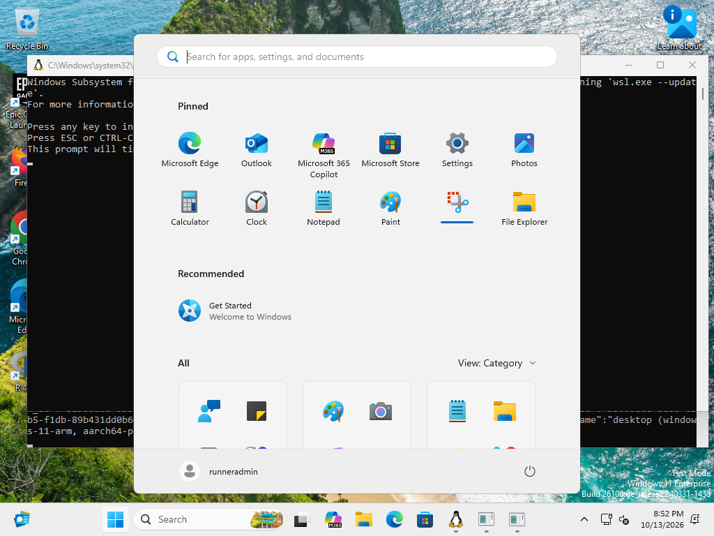

# R02 taskbar discovery evidence

Status: **hosted desktop experiments pass; NO-GO for the complete Windows 11 x64
support gate**. Actual remote desktop verification is now available, beyond Linux
unit tests and cross-compilation. No verified clock rectangle is enabled.

Tracking decision: [#3](https://github.com/tjorim/ElevenClock/issues/3) is the
completed probe/hosted-feasibility milestone; implementation is in PR #20.
Desktop variants blocked by hosted-runner limitations are consolidated in shared
[#21](https://github.com/tjorim/ElevenClock/issues/21). Hosted-capable hit testing
and UIA failure/lifetime work remain in #4/#9 and must be attempted in CI first.
Required desktop and hosted evidence together determine the GO before verified
rectangles or dependent production overlays are enabled. Closing the feasibility
milestone does not satisfy this gate.

## Recorded environments and results

[R02 desktop run 38508357876](https://github.com/tjorim/ElevenClock/actions/runs/38508357876)
passed all three jobs on feature commit `0eebd3a18e128551ed686cbffe362004b081b4a8`;
checked-out PR merge revision `d05e9e4a75ecd8fdbf6c30b28fe8e287b97726f6`.
Original structured output, contexts and original/annotated screenshots are
retained under [R02-hosted](R02-hosted/). Text fixtures normalize line endings and
omit the UTF-8 BOM; values are unchanged. Artifact archives retain original bytes.

| Actual OS | Native CPU / probe | Exact build + UBR | Image | Evidence |
| --- | --- | --- | --- | --- |
| Windows Server 2025 Datacenter | x64 / native x64 | **26100.33438** | win25-vs2026 20260925.250.1 | [Context](R02-hosted/server-x64/context.json), [artifact](https://github.com/tjorim/ElevenClock/actions/runs/38508357876/artifacts/11868418708) |
| Windows 11 Enterprise | ARM64 / native ARM64 | **26200.9457** | win11-vs2026-arm64 20261004.176.1 | [Context](R02-hosted/windows11-arm-native/context.json), [artifact](https://github.com/tjorim/ElevenClock/actions/runs/38508357876/artifacts/11868578593) |
| Windows 11 Enterprise | ARM64 / emulated x64 | **26200.9457** | win11-vs2026-arm64 20261004.176.1 | [Context](R02-hosted/windows11-arm-x64-emulated/context.json), [artifact](https://github.com/tjorim/ElevenClock/actions/runs/38508357876/artifacts/11868224228) |

Each desktop had **one 1024×768 display at 96 DPI**. The two Windows 11 rows are
the same OS build and CPU architecture, with different probe binaries. They are
**not two Windows 11 builds or a native Windows 11 x64 machine**. Hosted images
also contain development tools and a test-mode watermark; no stock-image claim
is made. Native CPU architecture is recorded independently of the executable
architecture so x64 emulation cannot be mistaken for an x64 OS. The contexts
retain actual source revisions and executable SHA-256 values.

All three profiles produced complete UIA inventories after desktop preparation,
handled an Explorer restart with no accepted stale geometry, recovered under a
new shell PID, terminated three confirmed injected stalls, and removed a
confirmed stalled helper when its parent was terminated. No helper remained
following those checks. Injected stalls are explicitly **synthetic process-lifetime
tests**, not evidence of COM cancellation or an actual blocked UIA provider.

| Probe profile | Baseline UIA latency, two samples | Longest completed UIA call | Observed deadline teardown, three injected stalls |
| --- | --- | --- | --- |
| Server native x64 | 170.863 / 153.158 ms | 13.888 / 9.647 ms | 10.339–10.393 ms |
| Windows 11 native ARM64 | 278.782 / 164.244 ms | 15.346 / 13.595 ms | 10.239–10.703 ms |
| Windows 11 emulated x64 | 355.256 / 307.578 ms | 54.247 / 28.640 ms | 10.505–10.900 ms |

Supervisor deadline results took approximately 5.02–5.03 seconds including
termination. Per-call records are in each profile's baseline/restart/recovered
JSONL. These are small recorded samples, not a latency distribution or soak test.
Explorer restart was initiated while a helper process was observed. The first
sample returned `probe_error` / `0x80070057` and later samples recovered with a
new Explorer PID. Exact overlap with a particular COM call is **not asserted**;
this proves observed probe/shell failure and recovery, not retained-object
staleness across a specific UIA call. New samples create fresh COM interfaces.

## Observed candidate and discovery decision

Native children expose notification/container geometry, but no independently
identified clock-only child in these captures. UIA is the preferred **experimental
candidate**, pending the required x64/mixed-DPI evidence and independent hit-target
verification. It is not enabled as a supported discovery strategy.

The observed locale-independent candidate is a visible XAML button with
`ClassName=SystemTray.OmniButtonLeft`, `ControlType=50000` and child AutomationIds
`TimeInnerTextBlock` and `DateInnerTextBlock`. Its own AutomationId is
`SystemTrayIcon`, which is shared by adjacent controls and is insufficient alone.
Indices differ across inventories; neither an ordinal nor a fixed offset is a
selector. No localized Name matching or control invocation is used.

In the six baseline samples, the candidate's measured rectangle was
`[910,720,984,768]`, inside taskbar `[0,720,1024,768]` and monitor
`[0,0,1024,768]`. Recorded neighboring button rectangles included
`SystemTray.OmniButtonRight` at `[984,720,1012,768]` (notification/bell area)
and `SystemTray.ShowDesktopButton` at `[1012,720,1024,768]`. The observed sibling
button rectangles did not overlap the candidate. These numbers are **observations,
not runtime constants**. Provider rectangles have not yet been independently
proven to exhaust every adjacent hit target on the required configurations.

[Server geometry observations](R02-hosted/server-x64/candidate-observations.json),
[native ARM observations](R02-hosted/windows11-arm-native/candidate-observations.json)
and [emulated x64 observations](R02-hosted/windows11-arm-x64-emulated/candidate-observations.json)
record containment, sibling bounds and the explicit unsupported-selector gate.
Original screenshots were inspected; their clock, notification and Show Desktop
areas match the recorded candidate locations. Annotated screenshots label raw
UIA indices (`U<number>`), not accepted overlay positions.



[Annotated native ARM capture](R02-hosted/windows11-arm-native/baseline-inventory.png),
[Server original](R02-hosted/server-x64/baseline-original.png) and
[emulated x64 original](R02-hosted/windows11-arm-x64-emulated/baseline-original.png).

## Actual failures and resulting fixes

The initial ARM image opened a profile privacy/setup page covering Explorer.
UIA returned only a root element. The initial diagnostic harness incorrectly
counted any taskbar inventory as successful desktop evidence; it now requires
an actual clock subtree. The original negative capture is retained in
[negative-emulated-startup](R02-hosted/negative-emulated-startup/).

The ephemeral-host preparation completes a known setup process using guarded
native Enter gestures, records its owner/actions, and waits for a real clock
subtree. It never changes the app's preferences. Preparing an OS profile is
restricted to an explicitly requested ephemeral GitHub runner harness.

After setup, the actual screenshot showed a taskbar, but `EnumWindows` alone
returned no taskbar inventory in the emulated probe. Discovery now supplements
it with bounded `FindWindowExW` searches for `Shell_TrayWnd` and
`Shell_SecondaryTrayWnd`, deduplicates the handles, and compares the complete
native state before/after discovery. All three final runs found the taskbar.
The captured failure and final successful runs support retaining direct class
lookup; they do not establish a general cause for EnumWindows omission.

## Developer reproduction

These are developer commands; probes, harnesses and injected-stall variables are
not installed user tools or linked into clock-app. The GUI app still has no
production helper integration. On an ephemeral Windows x64 desktop:

```powershell
cargo +stable build --manifest-path rust/Cargo.toml -p clock-windows --example taskbar_probe --target x86_64-pc-windows-msvc --locked
powershell -NoProfile -File scripts/test-rust-taskbar.ps1 -RestartExplorer
```

For a native ARM64 probe, build with `--target aarch64-pc-windows-msvc` and supply
that executable plus `-ProbeTarget aarch64-pc-windows-msvc` to the harness. The
[hosted workflow](../../.github/workflows/runtime-lifecycle.yml) does this automatically
and adds `-PrepareHostedDesktop` only for ephemeral GitHub machines. To capture
without restarting Explorer, omit `-RestartExplorer`. The harness stops only
Explorer processes in its own session, waits for recovery, and records failures.

For simple inventory capture, invoke the development example with an optional
sample count of 1..60 and retain JSONL/stdout, stderr and exit status. The helper
owns COM MTA initialization, interfaces, release and native handles; only values
are serialized. There is one active helper and one coalesced pending generation.
A five-second result deadline cannot cancel COM: the supervisor terminates the
helper, observes exit for up to one second, and refuses replacement on teardown
failure. Windows kill-on-close job ownership and a pre-COM startup handshake
cover parent loss. Output is read only after exit, capped at 8 MiB, and rejected
for a malformed/stale generation envelope. Every clock rectangle remains null.
The [ADR](../adr/0001-taskbar-discovery.md) records the lifetime decision.

The harness's `ELEVENCLOCK_R02_SIMULATE_STALL` / `ELEVENCLOCK_R02_STALL_READY`
variables are development-only fault injection in the example. It restores them
after testing. They cannot configure the product. A confirmed marker is written
only after job assignment/handshake, so an unstarted child cannot satisfy a stall
test. No UIA interface, HWND or HMONITOR appears in result channels.

## Verification and outstanding gate

[Rust foundation run 38508357771](https://github.com/tjorim/ElevenClock/actions/runs/38508357771)
passed all five Linux/Windows MSRV/stable jobs on the same feature revision:
formatting, Clippy, unit/doctests, locked native x64 release builds, native Settings
checks, advisory audit and license inventory. The initial local command record
used Rust 1.90.0 and stable 1.99.0; its formatting, core/workspace/all-targets tests,
Clippy and x64 MSVC cross-target checks passed. After the class-lookup change,
local MSRV probe tests and x64 cross-target Clippy also passed. Each workspace
all-targets run passes 10 unit tests plus one core doctest; an ignored subprocess
fixture is explicitly invoked by the supervisor tests. Actual native ARM and
emulated x64 development probe builds passed in the hosted evidence workflow.

- [x] Portable negative-coordinate/invalid/overflow/DPI/containment/adjacency/generation validation
- [x] Bounded/coalesced queue and malformed/stale envelope rejection
- [x] Actual hosted Windows Server and Windows 11 native/emulated probe execution
- [x] Original/annotated screenshots, exact builds, structured output and call latency
- [x] Observed Explorer failure/recovery with a new shell identity
- [x] Actual Windows jobs: three injected deadlines and confirmed stalled-helper parent loss, with no remaining helpers
- [ ] Two stock **Windows 11 x64 OS builds**, with exact build/UBR records
- [ ] Real mixed-DPI second display and negative-coordinate/topology observations
- [ ] Complete neighboring hit-target inventory and supported selectors: hosted automation in #4; unavailable native x64/mixed-DPI repetitions in #21
- [ ] Specific in-flight UIA stale-object and blocked-provider measurements: hosted validation in #9, not deferred solely for lack of local Windows
- [ ] Manual R02 go decision for downstream production discovery/overlay use

A suitable native Windows 11 x64 VM or desktop with two independently scaled
monitors can run this same harness; no terminal or preference edits are part of
an end-user flow. The currently available hosted alternatives cover meaningful
verification but cannot supply the remaining two-build/mixed-DPI support claim.
