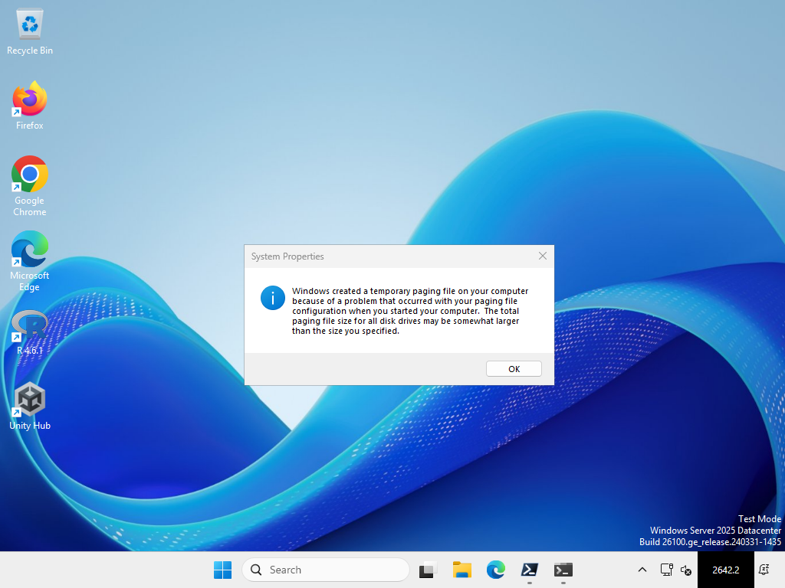
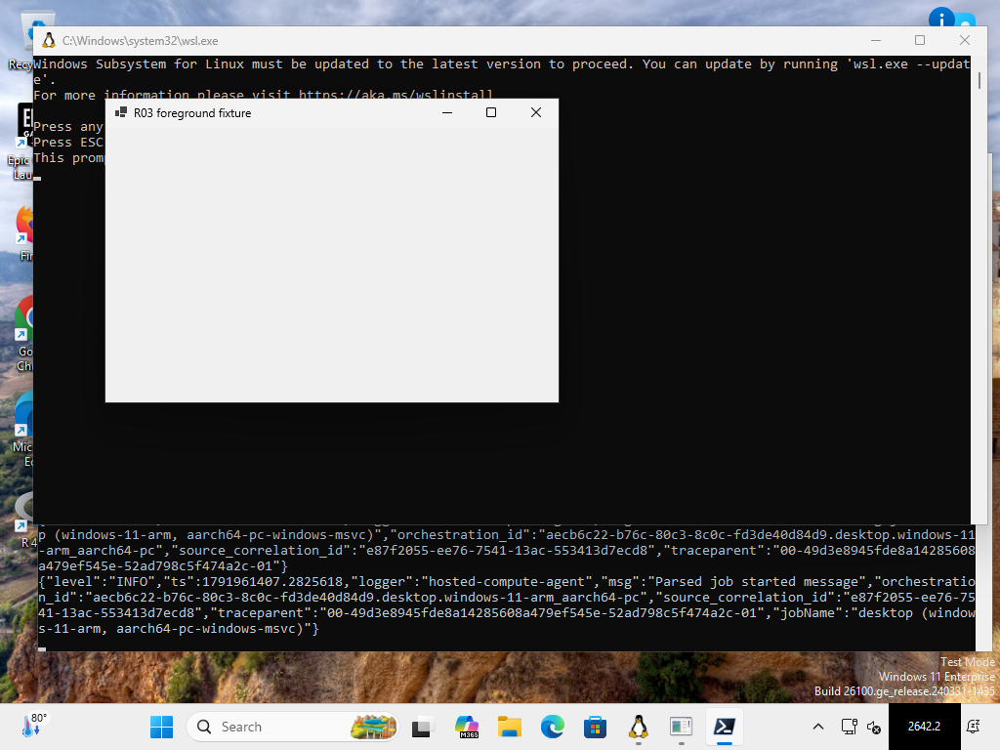
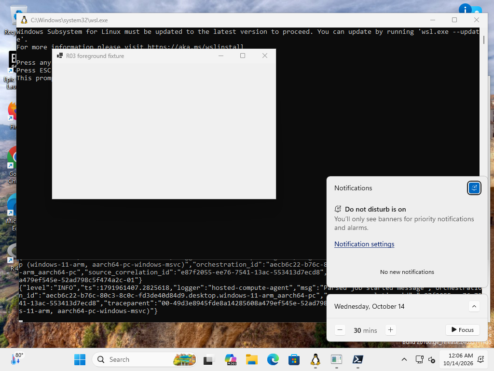

# R03 non-activating overlay spike

**P1 decision: still NO-GO for P3/production, now only because of
[#21](https://github.com/tjorim/ElevenClock/issues/21).** The original R03 run
below failed Explorer-restart recovery on every profile. The
[#23 follow-up](#23-recovery-follow-up) found the cause, a placement fix, and a
hosted rerun where every R03 criterion passes on all three profiles. R02's
unavailable stock native-x64 and mixed-DPI variants (#21) still block a GO. No
supported production selector, clock rectangle or app overlay is enabled.

## #23 recovery follow-up

[R03 run 38856440637](https://github.com/tjorim/ElevenClock-rs/actions/runs/38856440637)
ran PR head `f099956c764fb3fe414705239fe47102011a4183` (checkout/merge revision
`2ae216fcc294b2e3b2c489962504ad33b4979ed3`) on the same three hosted profiles
and builds as the original run. **All three jobs passed with no failed criteria.**
Contexts, JSON and representative original captures are retained in
[R03-recovery-hosted](R03-recovery-hosted/). Run artifacts expire after 14 days:
[Server](https://github.com/tjorim/ElevenClock-rs/actions/runs/38856440637/artifacts/12027935010),
[ARM64 native](https://github.com/tjorim/ElevenClock-rs/actions/runs/38856440637/artifacts/12026404494),
[ARM64 emulated x64](https://github.com/tjorim/ElevenClock-rs/actions/runs/38856440637/artifacts/12027287858).

**Cause.** While the desktop (`Progman`) is foreground, Windows ignores
`SetWindowPos(HWND_TOPMOST)` from a background process. The call returns success
but `WS_EX_TOPMOST` is not set, and inserting after another topmost window does
not set it either. The spike created its window non-topmost and promoted it
later. It recreates that window on every discovery cycle. After the Show Desktop
neighbor click, every new overlay therefore stayed visible *below* the taskbar.
The original `neighbors.json` logs show `own_topmost=false; show=true` from that
click onwards, before Explorer was even killed. A restarted Explorer leaves its
new desktop foreground, so recovery could never pass. `IsWindowVisible` was true
while the native clock kept the hit, which is what the original run measured.

**Local reproduction.** On a stock x64 Windows 11 26200.9457 desktop (merged
`OmniButton` layout), a real Show Desktop click and then a desktop click left
the unfixed spike visible but not topmost, with `WindowFromPoint` returning
`Shell_TrayWnd`. In that state a window *created* with `WS_EX_TOPMOST` was
topmost. A process that had just injected input could still promote its windows.
This points to a foreground-rights rule, not to Show Desktop itself. The exact
rule is not documented; this is the observed behavior.

**Amended placement.** Overlays are created with the taskbar's topmost style.
Hidden overlays keep their band instead of being demoted, because a hidden
window covers nothing and a demoted one may not be allowed back. A band change
that reports success without taking effect hides the overlay instead of showing
it below the taskbar. The spike and the runtime overlay
(`runtime/overlay_window.rs`) both use this. There is still no Explorer
parenting or style change and no unconditional global topmost. Coverage is still
inserted directly above the taskbar in its own band.

| Check (all three profiles) | Rerun result |
| --- | --- |
| Explorer restart | **Pass**: new shell PID, old coverage removed on loss, `explorer-recovered` capture with the native hit owned by the prototype and four opaque corners |
| 100% → 125% → original DPI | **Pass** in both directions, including Server, which failed restoration originally |
| Calendar | **Pass for deliberate Win+N**: one action, released keys, native notifications/calendar flyout visible in every `calendar-keyboard` capture. UIA Invoke again reported success without a visible flyout and is not accepted |
| Initial coverage, nonactivation, fullscreen, auto-hide, neighbors, forced termination, injected rejection | **Pass**, as in the original run |



[ARM64 native recovered](R03-recovery-hosted/windows11-arm-native/explorer-recovered.png),
[ARM64 emulated recovered](R03-recovery-hosted/windows11-arm-x64-emulated/explorer-recovered.png),
[Server DPI restored](R03-recovery-hosted/server-x64/dpi-restored.png),
[ARM64 DPI restored](R03-recovery-hosted/windows11-arm-native/dpi-restored.png), and
Win+N captures for [Server](R03-recovery-hosted/server-x64/calendar-keyboard.png),
[ARM64 native](R03-recovery-hosted/windows11-arm-native/calendar-keyboard.png) and
[ARM64 emulated](R03-recovery-hosted/windows11-arm-x64-emulated/calendar-keyboard.png)
are original captures.

**Limitations of this follow-up.**

- Server DPI restoration was not diagnosed. Its original failure was repeated
  discovery errors with no Win32 error code (`0x00000000`) after returning to 96 DPI. It
  did not recur in run 38839269799 (before this fix) or in this run. That is two
  clean runs, not a root cause; a recurrence should be treated as a regression of
  this criterion.
- Explorer was restarted on a local stock x64 desktop with the runtime app, and
  both taskbars recovered. The unfixed build also recovered there, so the local
  restart did not reproduce the failure. The hosted run is the restart evidence.
- In one local Show Desktop run, the fixed runtime overlay stayed topmost but the
  primary clock hit went to `Shell_TrayWnd` about one second after the click.
  That looks like the taskbar was raised above the overlay within the topmost
  band. It was a single sample and was not followed up. The runtime re-anchors
  only on shell events, so this belongs to the lifecycle work in #9.
- Mixed-DPI and stock native-x64 variants remain #21.

## Exact hosted evidence

[R03 run 38525901613](https://github.com/tjorim/ElevenClock/actions/runs/38525901613)
executed feature commit `59049385bf0e735dc7e884eb3c7e073bac529e72`; checkout/merge
revision **`b10847f66a3d4260d970d59341dd56a97942b145`**. Each profile's retained
context records the actual source, executable SHA-256, build/UBR, native CPU and
probe target. JSON values and representative original PNGs are retained in
[R03-hosted](R03-hosted/). Artifact archives contain every original capture and
R02 desktop-preparation output. Git normalizes context JSON line endings; values
are unchanged and archives retain original bytes. Images have not been synthesized
or edited.

| Actual OS | Native CPU / prototype | Exact build + UBR | Context and complete archive |
| --- | --- | --- | --- |
| Windows Server 2025 Datacenter | x64 / native x64 | **26100.33438** | [Context](R03-hosted/server-x64/context.json), [archive](https://github.com/tjorim/ElevenClock/actions/runs/38525901613/artifacts/11875971463) |
| Windows 11 Enterprise | ARM64 / native ARM64 | **26200.9457** | [Context](R03-hosted/windows11-arm-native/context.json), [archive](https://github.com/tjorim/ElevenClock/actions/runs/38525901613/artifacts/11875204553) |
| Windows 11 Enterprise | ARM64 / emulated x64 | **26200.9457** | [Context](R03-hosted/windows11-arm-x64-emulated/context.json), [archive](https://github.com/tjorim/ElevenClock/actions/runs/38525901613/artifacts/11876365625) |

All images had one **1024×768 display**. Actual scale changed through Windows
Settings from **96 to 120 DPI (100% to 125%)**. Both Windows 11 profiles restored
96 DPI and opaque coverage; Server lost discovery after scale restoration.
The two Windows 11 jobs are one OS build/architecture with different binaries,
not two Windows 11 builds or a native Windows 11 x64 OS. Hosted development images,
watermarks, startup brokers and paging-file dialogs are not stock desktop evidence.

## Acceptance and measured limitations

| Check | Recorded result |
| --- | --- |
| Initial primary/all-display clock coverage | Pass on available single display in all three profiles; native pointer hit belongs to prototype and four opaque corners verified before saving frame |
| Adjacent controls | Clock slot `[910,720,984,768]` does not intersect neighboring button rectangles; independent Rust UIA center hits and actual quick-settings/bell/Show Desktop clicks recorded |
| Nonactivation | Pass: fixture retained foreground on display; WS_EX_TOOLWINDOW/NOACTIVATE present, WS_EX_APPWINDOW absent |
| Alt-Tab | Documented toolwindow exclusion verified through actual styles; no Alt-Tab switcher screenshot captured |
| Fullscreen | Pass: actual topmost borderless foreground fixture covered the monitor; overlay hidden |
| Auto-hide | Pass: actual supported auto-hide setting/readback, physical pointer movement, hidden capture and opaque shown capture; not simulated messages |
| UIA Invoke | **Unusable in these captures:** one successful API call, no visible notifications/calendar flyout; not accepted as calendar success |
| Deliberate Win+N | Pass: a separately selected keyboard experiment/one physical click opened native notifications/calendar UI; exactly one action and released Win/N keys recorded |
| Forced termination | Pass: no prototype/helper/overlay remained; native clock visible and native hit returned to Explorer |
| Unsupported discovery | Pass: an initial live opaque lease followed by injected rejection removed coverage; native clock remained; explicitly synthetic rejection, not a blocked COM provider |
| Explorer loss | Pass: old-generation coverage removed on actual Explorer termination |
| Explorer recovery | **Fail in all profiles:** new shell identity/discovery observed, but actual opaque visible coverage did not recover; positive IsWindowVisible/SetWindowPos is insufficient |
| 100% → 125% DPI | Pass with actual Settings selection and 120-DPI opaque capture in all profiles |
| 125% → original DPI | Pass on both Windows 11 profiles; **Server fails rediscovery** (`Overlay visible=True not observed`); no guessed rectangle accepted |
| Two stock Windows 11 native-x64 builds, two mixed-DPI displays/negative topology | Unchecked; established R02 hosted-runner limitation, owned by #21 |

The automated R03 workflow is **red intentionally on measured failed criteria**;
no failure was reclassified as successful compatibility. Server additionally stops
at the DPI restore failure. The report records all demonstrated cases rather than
claiming a universal Windows compatibility result. UIA errors/stalls and retained
provider-object validation remain R09/#9 work; process teardown does not prove
COM cancellation.





[UIA no-flyout capture](R03-hosted/windows11-arm-native/calendar-after-click.png),
[fullscreen](R03-hosted/windows11-arm-native/fullscreen-hidden.png),
[auto-hide hidden](R03-hosted/windows11-arm-native/autohide-hidden.png),
[auto-hide shown](R03-hosted/windows11-arm-native/autohide-shown.png),
[125% opaque coverage](R03-hosted/windows11-arm-native/dpi-125.png),
[96-DPI restored](R03-hosted/windows11-arm-native/dpi-restored.png),
[forced termination](R03-hosted/windows11-arm-native/forced-termination-native.png),
[unsupported removal](R03-hosted/windows11-arm-native/unsupported-native.png),
[quick-settings click](R03-hosted/windows11-arm-native/neighbor-1.png),
[bell click](R03-hosted/windows11-arm-native/neighbor-2.png),
[Show Desktop](R03-hosted/windows11-arm-native/neighbor-3.png),
[Explorer loss](R03-hosted/windows11-arm-native/explorer-loss.png),
and [failed recovery](R03-hosted/windows11-arm-native/explorer-recovery-failure.png)
are original captures. Screenshot inspection confirms initial coverage, native
keyboard UI and native fallback. Quick-settings capture shows its loading panel;
complete settings-panel functionality is not asserted from that single frame.

## Prototype entry and changed interfaces

The separate `clock-overlay-spike` development binary is excluded from the
installed `clock-app` and from app release artifacts. Native overlay/interaction
code requires the opt-in `clock-windows/overlay-spike` feature, enabled only by
this development package; core models and R02's production gate are unchanged.

On an ephemeral Windows MSVC/SDK development desktop:

```powershell
cargo +1.90.0 build --manifest-path rust/Cargo.toml -p clock-overlay-spike --target x86_64-pc-windows-msvc --locked
rust/target/x86_64-pc-windows-msvc/debug/clock-overlay-spike.exe evidence.json 180 primary-keyboard
```

Use `all-keyboard` for all discovered displays. `primary`/`all` test UIA only;
`primary-win-n`/`all-win-n` permit fallback only for an absent pattern.
`primary-keyboard`/`all-keyboard` select a separate deliberate keyboard strategy,
never retrying a successful/ambiguous UIA invoke on the same click.
`primary-reject` is a developer fault fixture: first successful discovery followed
by rejection. Duration is bounded to 1..300 seconds. These arguments/evidence files
are not an installed command suite, user preferences or normal support flow.

Public experimental interfaces add `ExperimentSlot`, `Update`, `overlay::run`,
portable visibility/band decisions and helper-only `prototype_interaction`.
Slots contain owned physical geometry/DPI/shell epoch values, never HWNDs or COM
objects. The new package carries its own GUI-subsystem/per-monitor DPI-v2,
asInvoker/uiAccess=false manifest; R02's example manifest behavior is unaffected.

## Measured integration strategy

R02 isolated discovery supplies candidate identity, physical geometry, DPI and
shell PID plus creation time. R03 additionally resolves a four-pixel interior grid
plus final edges independently to the native clock button, and sibling button
centers to their native controls. Missing/ambiguous clock IDs, incomplete UIA,
missing bell/Show Desktop, overlap, failed hit samples or changed native epoch
reject the experiment. These samples do not establish every possible neighboring
hit target or R02's supported-selector contract on untested configurations.

The calling UI thread owns HWND/GDI/class resources. The opaque black WS_POPUP
surface draws `2642.2` only inside the measured clock button. Toolwindow/noactivate
styles and MA_NOACTIVATE prevent overlay focus. A scalar press flag plus mouse
capture pairs press/release; cancellation or release outside the slot does not
invoke. The harness confirms a stable actual native pointer target before one
physical click, not repeated input to get a passing result.

Z-order mirrors the visible taskbar's documented topmost classification. A hidden
surface enters that classification if needed, then inserts relative to the nearest
predecessor with the same classification; an already adjacent surface preserves
order. Hidden/fullscreen coverage is hidden and demoted. Only the prototype's
HWND changes. There is no Explorer parenting/style/clock-disable operation and
no unconditional global topmost policy. As first measured, this strategy **did
not pass recovery**: windows were created non-topmost and promoted later. The
[#23 amendment](#23-recovery-follow-up) creates them in the taskbar's band and
passes recovery. Metadata and API success are still not substitutes for visible
coverage.

A 25-ms native poll checks taskbar bounds, DPI, PID/creation time and foreground
monitor coverage. Unknown foreground, sliding/hidden taskbar, fullscreen, stale
identity or expired eight-second lease hides coverage. Before each blocking
probe the UI destroys coverage and acknowledges removal to the worker. One helper
is attached to a kill-on-close one-process job before its stdin handshake permits
native/COM work. COM interfaces stay on that helper's MTA thread. Five-second
supervision plus bounded observed teardown precedes replacement; fatal teardown,
malformed/stale/oversized envelopes or missing UI acknowledgement stops supervision.
R02's supervisor implementation and real process tests are reused.

Coverage is also removed before each interaction. A fresh native point/epoch check
cannot invoke the overlay. UIA Invoke is attempted once. The raw ABI preserves
S_OK + null as unavailable; provider errors or ambiguous invoke failure do not
permit another action. Win+N is one four-event SendInput batch, refuses held user
modifiers/N and attempts release of accepted key-downs on partial insertion.
No mouse click is replayed. GUI callbacks never perform blocking UIA discovery.

The spike deliberately has refresh gaps while rechecking independent native hits;
this is not a finished renderer/lifecycle or a production performance claim.
The source and process behavior preserve native access when the experiment exits,
is terminated or refuses discovery. Controlled rejection is synthetic; actual
provider cancellation/staleness is not claimed.

## P1 handoff and remaining work

[R02 evidence](discovery.md), [its ADR](../adr/0001-taskbar-discovery.md) and
[#21](https://github.com/tjorim/ElevenClock/issues/21) still require **NO-GO for
P3/production**. Closing R02's probe milestone #3 does not approve production
rectangles. R03 development was permitted before that GO.

The measured R03 feasibility work is complete. With the
[#23 amendment](#23-recovery-follow-up), the hosted matrix shows initial
coverage, Explorer-restart recovery, DPI change in both directions, nonactivation,
neighbor access, fullscreen and auto-hide removal and native fallback on the exact
hosted images. The supported calendar strategy is one deliberate Win+N, as R09
implements; UIA Invoke has no accepted functional claim. Those results are not
evidence for stock native-x64 builds, mixed-DPI or negative topologies, which
stay with #21.

P1 becomes a GO only when #21 adds that R02 evidence. Combine it with this R03
result; until then, do not enable production selectors or trade native access
for apparent coverage. PR #22 completed the prototype and evidence milestone in
#4.

## Exact developer verification

On the tested code, local **Rust 1.90.0 and stable 1.99.0** both passed:

```sh
cargo +<toolchain> fmt --manifest-path rust/Cargo.toml --all --check
cargo +<toolchain> test --manifest-path rust/Cargo.toml --workspace --all-targets --locked
cargo +<toolchain> test --manifest-path rust/Cargo.toml --workspace --doc --locked
cargo +<toolchain> clippy --manifest-path rust/Cargo.toml --workspace --all-targets --locked -- -D warnings
cargo +<toolchain> clippy --manifest-path rust/Cargo.toml --workspace --all-targets --target x86_64-pc-windows-msvc --locked -- -D warnings
```

Each all-target run passed **15 unit tests** and one core doctest separately;
two ignored subprocess fixtures are deliberately invoked by supervisor tests.
The new portable tests cover negative-coordinate visibility, fullscreen, changed
geometry/lease and promotion/demotion constraints. Cross-target Linux checks are
type/lint checks only.

[Rust foundation run 38525901610](https://github.com/tjorim/ElevenClock/actions/runs/38525901610)
checks native Windows MSRV/stable builds, formatting, warnings-denied Clippy,
unit/doctests, app release/resources/Settings tests, advisories and license notices.
[R02 run 38525901616](https://github.com/tjorim/ElevenClock/actions/runs/38525901616)
passed. R03's real native/emulated builds pass; its final GUI evidence run fails
on the measured criteria above. No mock, cross-compilation or earlier weaker
IsWindowVisible-only success is used to approve P1.
